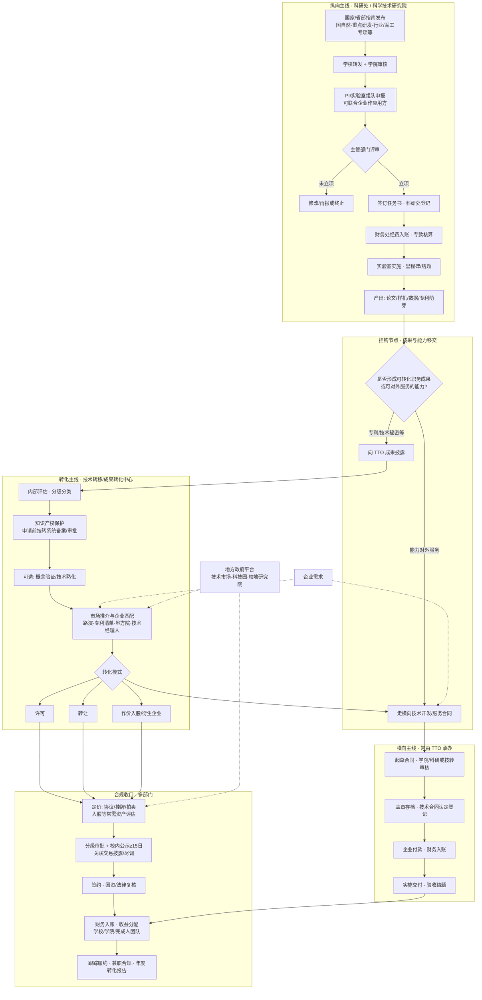

# 中国高校技术转移中心 / 成果转化中心典型工作流（2026-11-01）

> 用途：回答「学校对应的技术转移（俗称课题转移）机构如何把国家纵向科研、实验室能力与企业需求挂上钩」，并给出可引用流程图。  
> 原则：仅依据公开制度与高校办事指南归纳「中国高校典型实践」，非美国 TTO 模板照搬；校际细节有差异，下文标出共性。

---

## 1. 名称澄清：「课题转移中心」不是标准编制名

公开检索与教育部/科技部文件中，高校正式机构名通常是：

| 常见正式名称 | 代表院校公开表述 |
|---|---|
| 技术转移院 / 技术转移研究院 | 清华大学技术转移院（ott.tsinghua.edu.cn） |
| 技术转化研究院 / 工业技术转化研究院 | 浙江大学技术转化研究院（itt.zju.edu.cn） |
| 先进产业技术研究院 + 国家技术转移中心体系 | 上海交通大学产研院统筹，配套交大技术转移中心有限公司等（aitri.sjtu.edu.cn） |
| 技术转移中心 / 科技成果转化中心 / 知识产权与技术转移中心 | 南航、天大、武大、地大等大量高校；教育部认定「高等学校科技成果转化和技术转移基地」 |

**「课题转移中心」在公开编制名中几乎未见。** 业务语境里常与「技术转移中心」混用，或被口语化成「把课题/成果转出去的中心」。下文统一按官方称谓：**技术转移机构（TTO）/ 成果转化中心**。

---

## 2. 关键分责：纵向课题 ≠ TTO 主业；挂钩发生在「成果—能力—需求」节点

北京林业大学等校《科研项目和经费管理办法》类文件的通行定义：

- **纵向科研项目**：各级科技主管部门或政府机构批准立项、财政拨款的计划/基金（国自然、国家重点研发计划、省部专项、部分军工/行业专项等）。
- **横向科研项目**：企事业单位等委托，或以成果转化（开发/转让/许可/服务/咨询）形成的合同项目。

**山东理工大学等校办事流程公开材料**清楚显示分工：

- 纵向：计划管理科 / 科研处（科学技术研究院）主责——申报、任务书、登记、结题、纵向绩效。
- 横向与成果转化（转让/许可/作价入股）：**技术转移中心**承办。

因此：  
**「把国家纵向课题与实验室能做的项目挂钩」——申报与实施阶段主要是科研处 + 学院 + PI/实验室；TTO 通常在成果形成后（披露、专利、推介）以及企业横向对接时深度介入，而不是代替科研处发纵向指南或立项。**

清华技术转移院公开表述的转化链（价值培育→传递→实现）：

> 成果披露 → 成果评估 → 知识产权保护 → 市场推广 → 商务谈判 → 形成转化方案 → 审批/公示/签约或投资设立公司 → 跟踪服务与收益分配。

浙大、交大公开办事指南与此同构，差异主要在审批金额档位与归口部门名称。

---

## 3. 端到端典型步骤（中国高校共性）

### A. 纵向侧：国家课题如何进入实验室（科研处主线）

1. **主管部门发布指南/通知**（科技部、基金委、工信部、军方/行业主管、省市科技厅等）。
2. **学校科研处转发 + 限额/形式审查组织**；学院（二级单位）审核真实性与配套条件。
3. **PI / 实验室组队申报**（常联合企业作「应用示范/配套」——这是纵向与产业的早期挂钩点，但仍属纵向申报逻辑）。
4. **主管部门评审立项** → 签订任务书/合同书 → **科研处登记入库** → **财务处经费入账、专款核算**。
5. **实施与里程碑/结题验收**；过程中产生论文、样机、数据、专利萌芽。
6. **知识产权节点（政策要求嵌入全流程）**：教育部等《关于提升高等学校专利质量促进转化运用的若干意见》推动立项前专利导航、实施中挖掘、验收前 IP 清单；高价值成果应进入技转系统备案/披露（清华要求专利申请经「INFO-科研-技转系统」院系+技转院审批）。

### B. 转化侧：实验室成果/能力如何对接企业（TTO 主线）

7. **成果披露（Disclosure）**：完成人判断具商业化可能后，向 TTO 正式披露（清华提供技转信息系统入口）。
8. **内部评估 / 分级分类**：技术价值 × 市场价值（清华公开材料有 A/B/C 级专利支持逻辑）；决定是否布局专利、概念验证（PoC）熟化。
9. **知识产权保护**：职务发明学校为专利权人；委托代理所申请；涉密/军工另按保密规定。
10. **营销与匹配企业**：路演、专利清单推介、地方研究院/派出院对接、技术经理人走访实验室与企业（天大等公开描述技术经纪人模式）；地方政府技术交易市场、大学科技园、区域产业研究院参与撮合。
11. **转化模式选择**：
    - 许可（普通/排他/独占）
    - 转让
    - 作价入股 / 创办衍生企业
    - 或先以**横向技术开发/服务合同**把实验室能力卖给企业（更常见的「能力挂钩」路径）
12. **定价**：协议定价 / 挂牌 / 拍卖；转让与作价入股常需第三方资产评估（财政部事业单位国资处置要求；浙大现行细则对转让/许可可免评估、作价投资须评估——以各校最新文为准）。
13. **审批 + ≥15 日校内公示**（教育部、科技部《关于加强高等学校科技成果转移转化工作的若干意见》）：按金额分级（清华、浙大均公开金额档与决策层级）；关联交易须披露，重大关联常改挂牌。
14. **签约、技术合同认定登记、财务入账**；转让还需专利权人变更。
15. **收益分配**：扣除转化成本后，学校 / 学院 / 团队（及地方院等）按校规分成（清华公开示例团队不少于 50%；浙大公开分段比例完成人约 70% 起）。现金奖励走财务与个税备案；股权由资产公司代持再奖励。

### C. 「纵向成果 → 横向转化」如何真正挂钩（用户关心的核心）

典型不是「TTO 去改写国自然任务书」，而是三条并行挂钩：

| 挂钩方式 | 谁推动 | 说明 |
|---|---|---|
| **纵向产出 IP → 披露转化** | PI + TTO | 国拨课题做出的专利/技术秘密进入技转流程 |
| **能力画像 → 横向合同** | TTO/科技开发部 + PI | 用实验室在纵向中形成的设备、方法、团队能力接企业课题 |
| **申报阶段产学研联合** | 科研处组织、企业当联合单位 | 重点研发等要求应用单位，企业需求前移到指南响应 |

---

## 4. 纵向 vs 横向：分叉对照

| 维度 | 纵向 | 横向 / 成果转化合同 |
|---|---|---|
| 资金来源 | 财政科技计划/基金 | 企业/委托方付款或转化价款 |
| 校内主责 | 科研处（科学技术研究院）计划管理 | TTO / 技术转移中心；部分学校科技开发部管校企合作 |
| 立项依据 | 指南 + 评审 + 任务书 | 合同审批（大额常需可行性论证） |
| 考核 | 任务指标、绩效评价、结题报告系统 | 合同验收、委托方证明 |
| 知识产权 | 任务书约定 + 学校职务成果制度；常须披露后转化 | 合同约定归属；转化类须公示审批 |
| TTO 角色 | 辅：IP 质量、专利导航、结题成果挖掘 | 主：合同、推介、许可/转让/入股 |

---

## 5. 角色一览

| 角色 | 典型职责 |
|---|---|
| **实验室 / PI / 完成人** | 申报与执行纵向；披露成果；参与谈判；不得擅自转让职务成果 |
| **学院（二级单位）** | 形式/真实性审核、初审转化申请、组织条件保障 |
| **科研处 / 科学技术研究院** | 纵向全周期；部分学校仍统筹转化政策与定价审核（如浙大科研院在审批链中） |
| **技术转移机构（TTO）** | 披露、评估、专利、推介、转化合同、技术经理人；横向承办（多校） |
| **财务处** | 入账、专款核算、奖酬金、免税票据配合 |
| **国资 / 资产经营公司** | 作价入股股权代持、评估合规、经营性资产 |
| **法律 / 合规** | 合同效力、关联交易、尽职调查（清华公开尽调办法经验） |
| **企业** | 联合申报、委托研发、受让/被许可方、衍生公司运营 |
| **地方政府平台** | 技术交易市场挂牌、成果转化专项资金、校地研究院/派出院、大学科技园孵化 |

---

## 6. Mermaid 流程图（可直接粘贴）

---

## 7. 主要公开来源（核验用）

1. 清华大学技术转移院：成果披露/成果转化页面；国家知识产权局附件《清华大学技术转移实践与探索》PDF（披露→评估→IP→推广→洽谈→审批签约→跟踪→收益）。  
2. 清华五道口相关报告《高等院校科技成果转化工作框架》（价值培育—传递—实现）。  
3. 浙江大学技术转化研究院 Q&A 与《科技成果转化审批细则》公开文本（申请→审批档位→公示→评估规则→收益分段）。  
4. 上海交通大学：《科技成果转化组织实施管理办法》；集成电路学院办事指南「知识产权许可、转让流程」；产研院技转机构说明。  
5. 教育部、科技部《关于加强高等学校科技成果转移转化工作的若干意见》（机制、公示≥15 日、横向同等考核等）。  
6. 教育部科技司首批基地典型经验（清华尽调、浙大关联交易、多校流程图汇编说明）。  
7. 山东理工大学《科研业务办理流程》PDF（纵向 vs 横向 vs 技术转让/挂牌/入股分科承办）。  
8. 北京林业大学科研项目和经费管理办法（纵横向定义与部门职责）。

---

## 8. 对业务产品的直接含义（产教/供需匹配）

若做「高校能力 ↔ 企业需求」平台：

- **不要假设每个学校有一个叫「课题转移中心」的统一 API**；对接对象应拆成：**科研处（纵向与实验室名录）**、**TTO（专利与转化清单）**、**科技开发/地方研究院（横向与校地）**。  
- 数据冷启动优先：**公开专利权利人=高校、公开横向技术合同登记信息、高校成果路演/专利清单、OpenAlex 论文团队**；纵项任务书细节多为非公开。  
- 匹配叙事应对齐真实挂钩点：**能力卡（实验室方法/设备/团队）** 与 **IP 卡（可许可专利）** 分开，再对企业需求；通知对象优先 PI + 院系科研秘书 + 技术经理人，而非虚构的「课题转移中心邮箱」。

